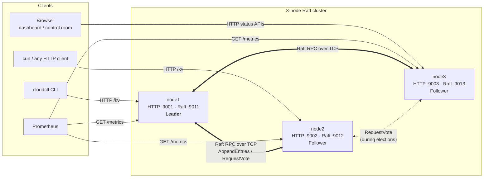
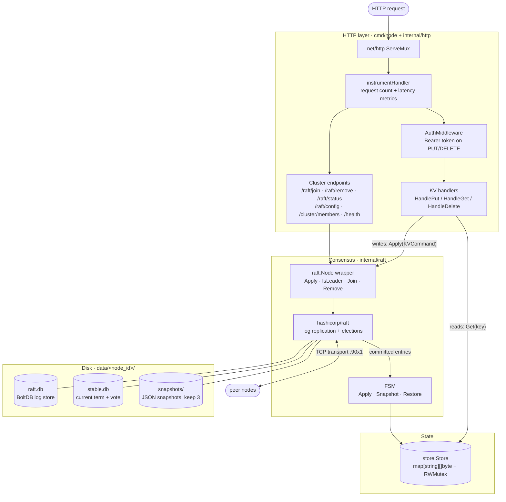
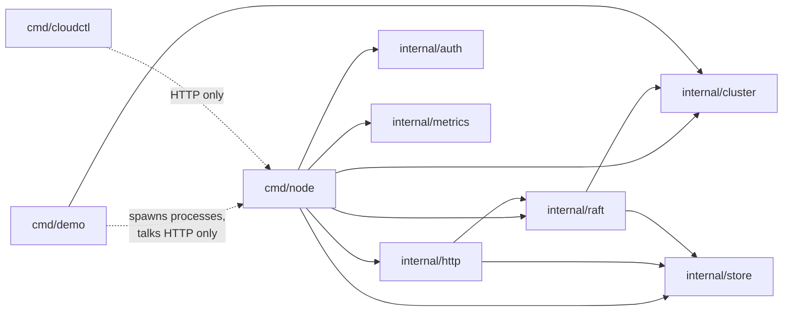
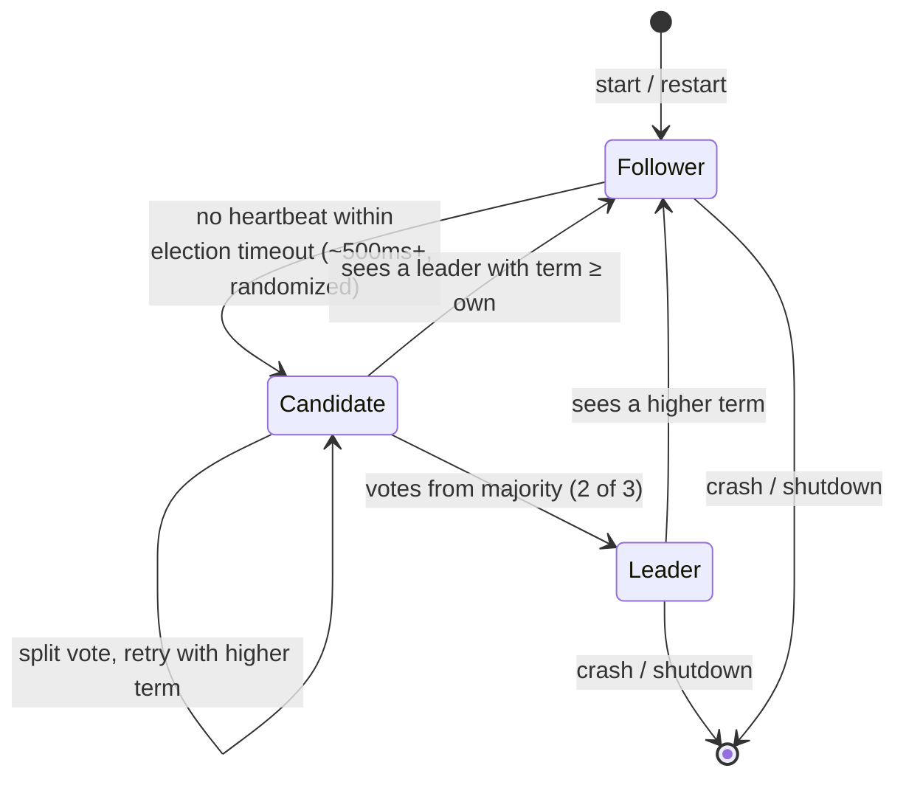
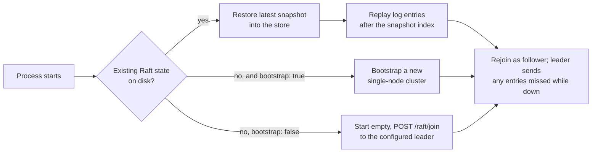

# Architecture

Mini Cloud is a replicated key–value store. Three Go processes ("nodes") each hold a full copy of the data and use the [Raft consensus algorithm](https://raft.github.io/) to agree on the order of every write. That way the cluster keeps serving requests and loses no acknowledged write when any single node crashes.

- Raft itself comes from [`hashicorp/raft`](https://github.com/hashicorp/raft), the library behind Consul and Nomad.
- This project builds the rest around it: the replicated state machine, HTTP API, cluster membership, persistence wiring, auth, metrics, tooling and a failure-injection demo.

**Contents**
1. [System overview](#system-overview)
2. [Inside a node](#inside-a-node)
3. [Code layout](#code-layout)
4. [Replication model](#replication-model)
5. [Persistence and recovery](#persistence-and-recovery)
6. [Cluster membership](#cluster-membership)
7. [Observability](#observability)
8. [Design decisions and trade-offs](#design-decisions-and-trade-offs)

See also: [request flows (sequence diagrams)](request-flows.md) · [demo and measured metrics](demo-and-metrics.md)

---

## System overview

- **Two ports per node.**
  - An HTTP port serves clients.
  - A Raft port, the HTTP port + 10, carries node-to-node consensus traffic over TCP.
- **One leader at a time.** Only the leader accepts writes. It appends each write to its log and replicates it to the followers. A write is *committed* once a majority (2 of 3) has stored it.
- **Reads go to any node.** Each node answers from its own in-memory copy. See [the consistency trade-off](#design-decisions-and-trade-offs).
- **Leader failure.** If the leader stops sending heartbeats, followers time out and hold an election. The cluster survives the loss of any one node, which is ⌊(3−1)/2⌋ = 1.

## Inside a node

Each node is a single binary ([`cmd/node`](../cmd/node/main.go)) wiring these layers together:

The key idea is the **replicated state machine**:

1. A write is never applied to the store directly.
2. The handler wraps it in a `KVCommand` (`{"op":"put","key":"k","value":"..."}`) and hands it to Raft.
3. Raft puts it in the same position of every node's log.
4. Every node's `FSM.Apply` executes the log in that order.

Because every node applies the same commands in the same order, every store ends up identical.

## Code layout

| Path | Responsibility |
|---|---|
| [`cmd/node`](../cmd/node/main.go) | Node entry point: config loading, Raft startup, auto-join, routes, metrics, graceful shutdown |
| [`cmd/cloudctl`](../cmd/cloudctl/main.go) | CLI client: `put`, `get`, `delete`, `members`, `status` |
| [`cmd/demo`](../cmd/demo) | Process supervisor, load generator, write verifier and control room server ([details](demo-and-metrics.md)) |
| [`internal/raft`](../internal/raft) | `Node` wrapper around hashicorp/raft (transport, BoltDB stores, bootstrap) and the `FSM` |
| [`internal/store`](../internal/store/store.go) | Thread-safe in-memory map, the state the FSM mutates |
| [`internal/http`](../internal/http/handlers.go) | KV request handlers, written against a small `RaftNode` interface so they can be unit-tested with a fake |
| [`internal/auth`](../internal/auth/middleware.go) | Bearer-token middleware for write operations |
| [`internal/metrics`](../internal/metrics/metrics.go) | Prometheus counters, histograms and gauges |
| [`internal/cluster`](../internal/cluster) | YAML config schema and loader |
| [`web/`](../web) | Single-node dashboard and the multi-node control room |
| [`test/`](../test/integration_test.go) | Multi-node integration tests: replication, snapshot restore, join/remove |

## Replication model

| Setting | Value | Why |
|---|---|---|
| Heartbeat timeout | 500 ms | Half the library default, so failures are detected sooner |
| Election timeout | 500 ms (randomized up to 2×) | Randomization avoids split votes |
| Leader lease timeout | 250 ms | A leader that loses contact with the majority steps down quickly |
| `Apply` timeout | 10 s | Upper bound a client waits for a write to commit |
| Commit rule | Majority (2 of 3) | Tolerates one failed node |

A write is acknowledged (HTTP 204) only after it is **committed on a majority and applied on the leader**. That is why a crash of any single node, leader included, can never lose an acknowledged write. The [demo](demo-and-metrics.md) checks this by reading back every acknowledged key after repeated leader kills.

## Persistence and recovery

Each node persists three things under `data/<node_id>/`:

| File | Contents | Written when |
|---|---|---|
| `raft.db` (BoltDB) | The Raft log: every `KVCommand` with its index and term | Every append, fsynced before a follower acknowledges |
| `stable.db` (BoltDB) | Current term and who this node voted for | On term change / vote, so a restarted node can't vote twice |
| `snapshots/` | JSON dump of the whole store at some log index (3 retained) | Periodically, by library defaults (every 120 s if ≥ 8192 new entries) |

The key–value store itself is in memory only. On restart:

Snapshots keep restarts fast and stop the log from growing without limit. Their format is a plain JSON map, so it's easy to inspect.

## Cluster membership

- Membership is itself stored in the Raft log, so every node agrees on who is in the cluster.
- `node1` is configured with `bootstrap: true` and creates a one-member cluster on first start.
- `node2` and `node3` have `join_url` set. Two seconds after starting they `POST /raft/join` to that URL, and the leader calls `AddVoter`, which replicates a configuration-change entry.
- `POST /raft/remove` on the leader removes a node the same way.
- Live membership is visible at `/raft/config` and `/cluster/members`.

## Observability

| Signal | Where | What |
|---|---|---|
| Prometheus metrics | `GET /metrics` | `http_requests_total{method,endpoint,status}`, `http_request_duration_seconds`, `kv_{put,get,delete}_operations_total`, `kv_store_size`, `raft_is_leader`, `raft_commit_index`, `raft_applied_index` |
| Raft status | `GET /raft/status` | Node ID, role, current leader, term, last log / commit / applied index, key count |
| Structured logs | stdout (zap, JSON) | Startup, joins/removals, errors, shutdown |
| Dashboard | `GET /dashboard` | Single-node status page |
| Control room | `go run ./cmd/demo` | Whole-cluster live view with failure injection and load ([details](demo-and-metrics.md)) |

The Raft gauges and `kv_store_size` are refreshed whenever `/raft/status` is read. The dashboard and control room poll it continuously.

## Design decisions and trade-offs

| Decision | Alternative | Reasoning |
|---|---|---|
| Use `hashicorp/raft` rather than implement Raft from scratch | Own implementation | Correctness of a consensus core is hard to establish. The interesting work here is everything around it: the state machine, persistence wiring, membership, failure handling and measurement. |
| Writes only on the leader; followers reply `400 Not the leader` with an `X-Leader` header | Proxy or `307` redirect to the leader | Keeps the request path simple and explicit. The `X-Leader` header holds the leader's **Raft** address, so clients (and the demo load generator) find the leader via `/raft/status`. Forwarding writes to the leader is a natural next step. |
| Reads served from the local store on any node | Route all reads through the leader, or check leadership first | Fast reads that scale with replicas. The cost is that **a follower can return data a few milliseconds stale**, and a leader that was just deposed may briefly serve a stale read. Making reads strictly linearizable would mean calling `raft.VerifyLeader()` (or a `Barrier`) before reading on the leader, and forwarding follower reads. That's a planned improvement. |
| In-memory store + snapshots + log replay | Store data in BoltDB directly | Simplest correct design for a small dataset. Memory use grows with the dataset, which is the main limit on scale. |
| JSON for commands and snapshots | Protobuf / gob | Human-readable while debugging. Binary encoding would be faster and smaller. |
| Short (500 ms) Raft timeouts | Library defaults (1 s) | Faster failover on a LAN. Too short on a slow network causes needless elections. |
| Bearer token only on writes | mTLS between nodes, auth on reads | Enough to show the middleware pattern. Raft traffic between nodes isn't encrypted, so it should only run on a trusted network. |
