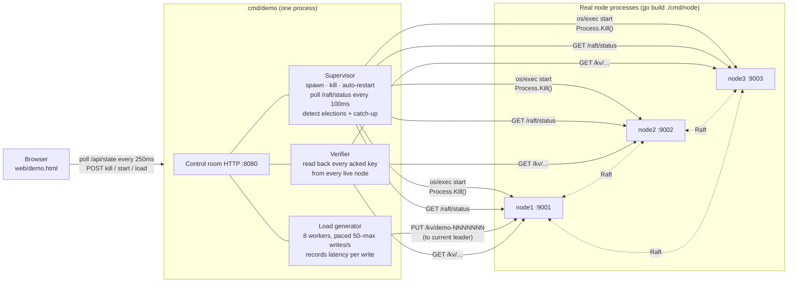

# Demo and measured metrics

The project ships with a **live control room**. It runs a real 3-node cluster, lets you crash nodes under write load, and measures what happens. The same harness has a headless benchmark mode that produced the numbers below.

See also: [architecture](architecture.md) · [request flows](request-flows.md)

## Headline numbers

| | |
|---|---|
| **0** acknowledged writes lost | across 10 hard leader kills under load (4,737 writes verified on all 3 nodes) and a 7,959-write throughput run |
| **1.03 s** median failover | time from killing the leader to a new leader being elected (p90 1.27 s, max 1.33 s) |
| **1.04 s** median write pause | how long clients could not write during a failover (p90 1.28 s) |
| **796 writes/s** | sustained, replicated to 3 nodes with fsync, 8 concurrent clients |
| **4.6 ms / 11.5 ms** | write latency p50 / p99, including the majority commit |
| **0.7 s** median catch-up | a crashed node restarting, replaying its log and catching up with the leader (~8k keys) |

## Running it

```bash
go run ./cmd/demo
```

Open http://127.0.0.1:8080, then:
1. Choose a write rate and press **Start load**.
2. Press **Kill leader**. Watch the cluster lose its leader, elect a new one, and resume writes. About 3 s later the killed node restarts and catches up.
3. Press **Stop & verify**. Every acknowledged write is read back from every live node.

To reproduce the benchmark without the UI (about 2 minutes):

```bash
go run ./cmd/demo -bench 10
```

## How the demo works



- **Real processes, real crashes.** The supervisor builds `cmd/node`, starts three OS processes and kills them with `Process.Kill()`: no graceful shutdown and no chance to flush anything.
- **No special hooks in the node.** The demo uses only the node's public HTTP API, the same one any client would use.
- **Isolated data.** Demo nodes run in `data/demo/` so they never touch data from nodes started by hand.

### What each metric means

Illustrative timeline of one failover (the leader is killed at t = 1000 ms):

```mermaid
gantt
    title One failover (illustrative timings)
    dateFormat  x
    axisFormat  %L ms
    section Leader node1
    serving writes          :done, 0, 1000
    section Followers
    waiting for heartbeat   :active, 1000, 1550
    election (RequestVote)  :active, 1550, 2030
    node2 leading           :done, 2030, 3000
    section Clients
    writes acknowledged     :done, 0, 990
    write gap               :crit, 990, 2040
    writes acknowledged     :done, 2040, 3000
```



| Metric | Start | End | Measured by |
|---|---|---|---|
| **Election time** | The supervisor calls `Process.Kill()` on the leader | The first status poll where another node reports `is_leader: true` | Supervisor (100 ms polling, so ±100 ms) |
| **Write gap** | The last write acknowledged before the kill | The first write acknowledged after it | Load generator (per-request timestamps) |
| **Catch-up time** | The supervisor restarts the killed node | The node's `applied_index` reaches the leader's commit index from the moment of restart | Supervisor |
| **Lost writes** | n/a | n/a | Verifier: every key that got `204` is read back from every live node with up to 6 retries; a key missing on all of them counts as lost |
| **Throughput / latency** | Request sent | `204` received | Load generator; latency is the full HTTP round trip, including the majority commit |

Writes that fail during a failover are **not** counted as lost. The client was told they failed, so it would retry them. Only a write the cluster *acknowledged* and then forgot would count as lost.

## Benchmark results

Run with `go run ./cmd/demo -bench 10` on 2026-11-07.

**Environment:** Windows 11, Intel Core i9-13900H (20 logical CPUs), 32 GB RAM, Go 1.24.10. All three nodes run on one machine over loopback, so the numbers have no real network latency (see [caveats](#caveats)).

### Throughput (8 concurrent clients, 10 s, no failures injected)

| Metric | Value |
|---|---|
| Acknowledged writes | 7,959 |
| Throughput | 796 writes/s |
| Write latency p50 | 4.6 ms |
| Write latency p99 | 11.5 ms |
| Lost acknowledged writes | 0 of 7,959 |

### Leader failover (10 hard kills of the leader at 100 writes/s)

| Metric | p50 | p90 | max |
|---|---|---|---|
| Time to elect a new leader | 1.03 s | 1.27 s | 1.33 s |
| Write gap seen by clients | 1.04 s | 1.28 s | 1.35 s |
| Restarted node catch-up | 703 ms | 942 ms | 1.01 s |

| Metric | Value |
|---|---|
| Writes attempted during the failover run | 5,784 |
| Acknowledged | 4,737 |
| Rejected while there was no leader | 1,047 |
| Lost acknowledged writes | **0 of 4,737** (verified on all 3 nodes) |

### Reading the numbers

- **About 1 s to fail over** follows from the Raft settings. Followers wait at least the 500 ms heartbeat timeout, and the library randomizes timeouts up to about 2× so that two followers rarely become candidates at once. A vote round trip on loopback is under a millisecond. Lower timeouts would fail over faster but cause needless elections when the network is merely slow.
- **The write gap tracks the election time almost exactly** (within about 10 ms). Once a new leader exists, the load generator finds it on its next status poll and the first write commits immediately. The outage is almost entirely failure detection.
- **About 18% of requests failed during the failover run** (1,047 of 5,784). That is roughly 1 s of unavailability per kill at 100 writes/s, plus the immediate retries the load generator makes while there is no leader. None of these were acknowledged, so none could be lost.
- **Throughput is bounded by fsync.** Every write is fsynced to the leader's BoltDB log and to at least one follower's before it is acknowledged. hashicorp/raft batches concurrent writes into one disk write, which is why 8 clients reach roughly 800 writes/s at about 5 ms each.

## Test coverage

`go test -cover ./internal/...`

| Package | Coverage | What's tested |
|---|---|---|
| `internal/store` | 100% | Put / Get / Delete / Len / Dump / Load, concurrent access |
| `internal/http` | 61.5% | Handlers against a fake Raft node: leader writes, follower rejection, reads, 404s |
| `internal/raft` | 17.0% | FSM apply, snapshot and restore round-trip |
| `test/` (integration) | n/a | Multi-node replication, snapshot restore, read verification, join and remove |

The Raft wrapper's low unit coverage is mostly startup and transport wiring, which the integration tests and the failover benchmark exercise end to end.

## Caveats

- **Single machine.** All nodes share one CPU, one disk and loopback networking. On real separate machines, each write pays at least one network round trip, which raises latency, and fsyncs no longer compete for one disk, which can raise throughput. Failover time would barely change, because it's dominated by the timeouts.
- **Crash-stop failures only.** The demo kills processes. It doesn't simulate network partitions, slow disks or clock skew. Raft handles partitions safely, but they aren't measured here.
- **Small values.** Keys and values are about 12 bytes. Large values would lower throughput.
- **Reads aren't strictly linearizable.** Reads are served from each node's local copy. See [design trade-offs](architecture.md#design-decisions-and-trade-offs).
