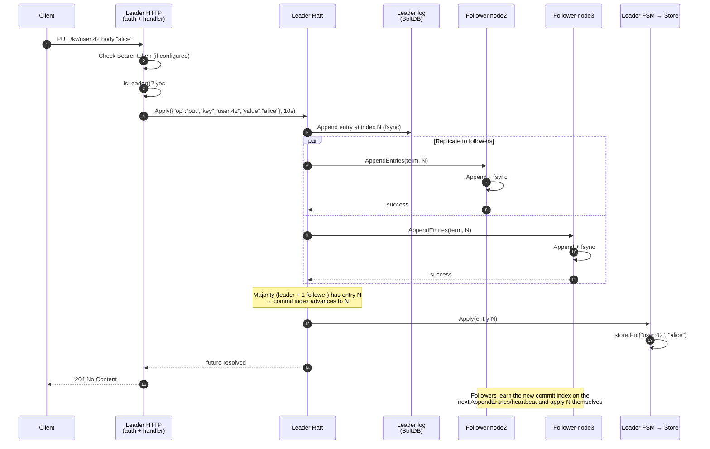
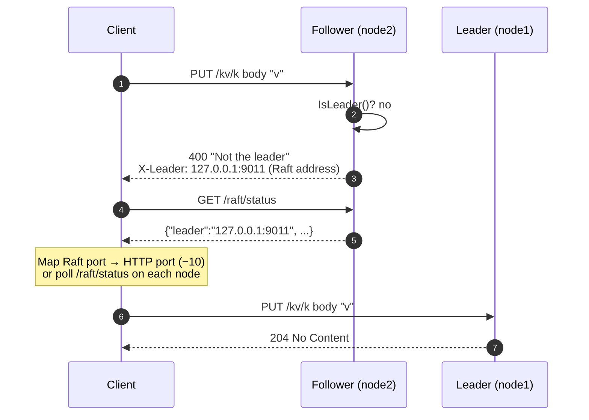
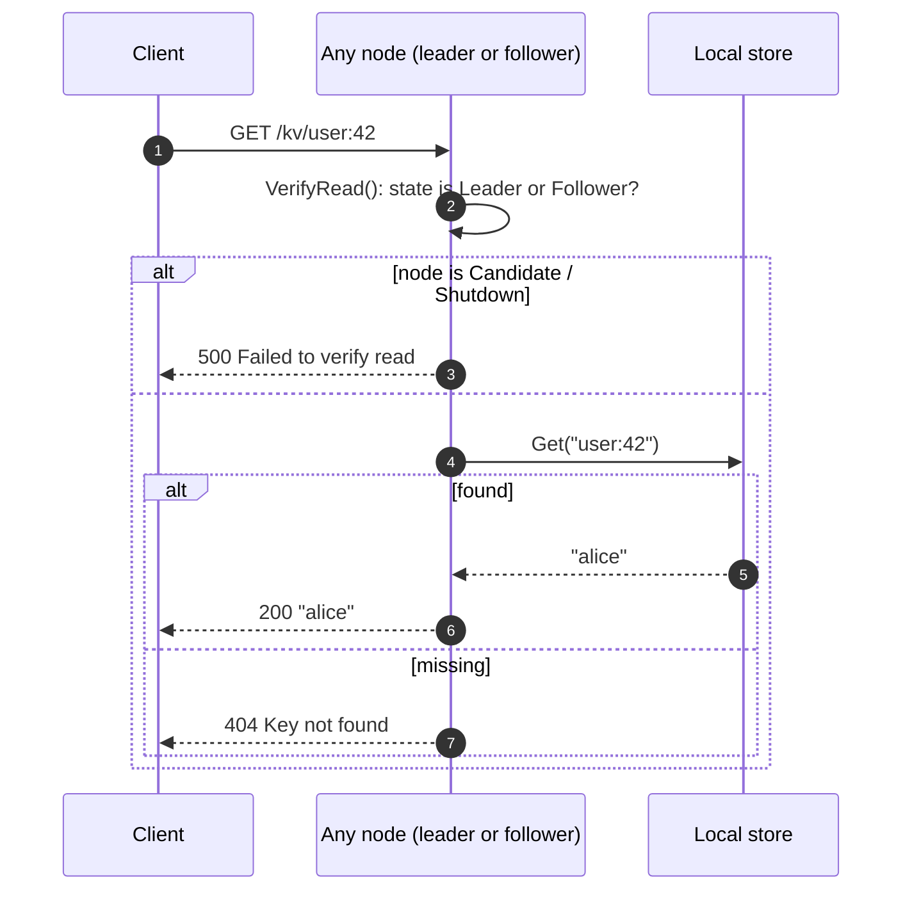
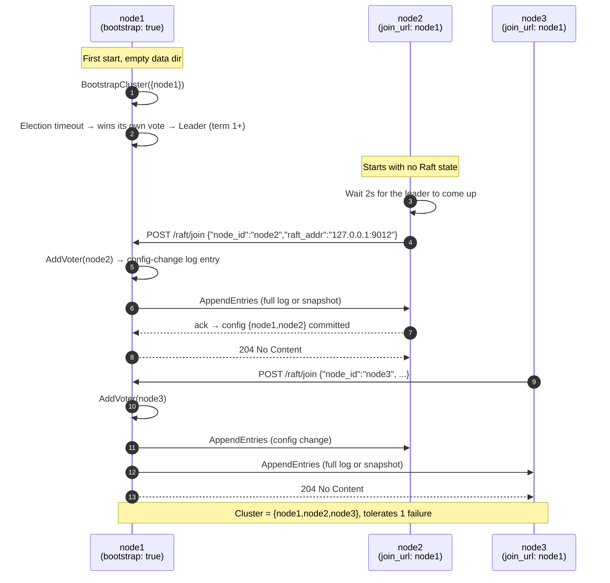
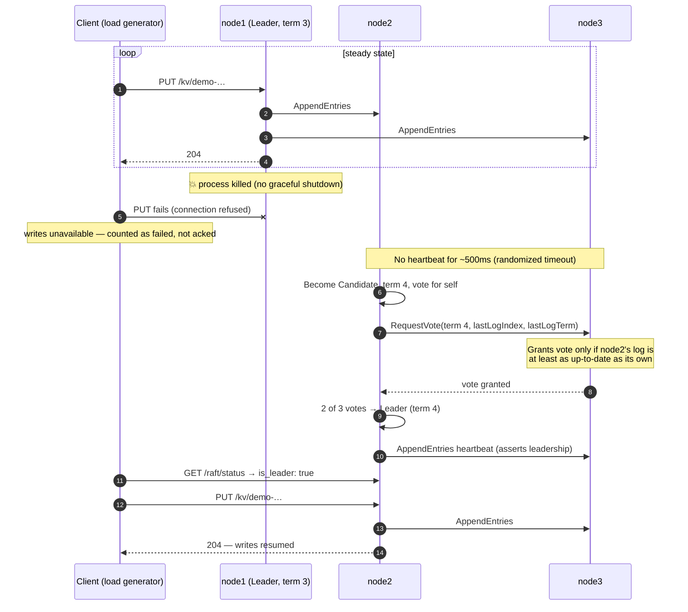
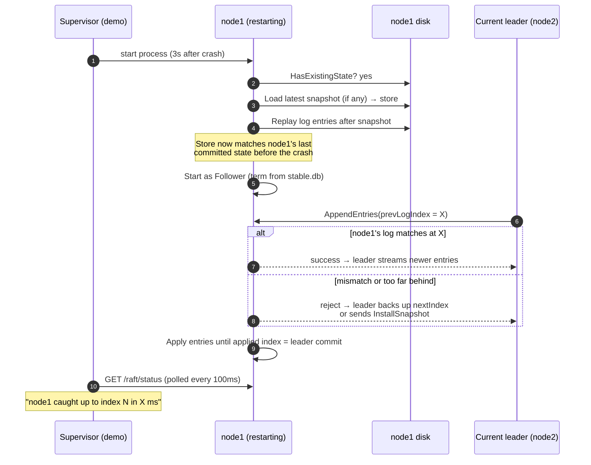
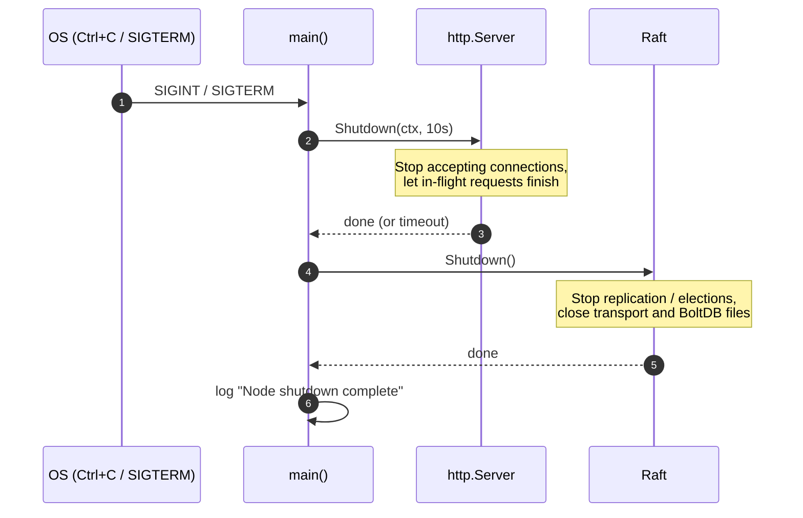

# Request flows

Sequence diagrams for the main paths through the system. Each one matches the current code, with links to where the behavior lives.

See also: [architecture](architecture.md) · [API reference](API.md) · [demo and measured metrics](demo-and-metrics.md)

1. [Write to the leader](#1-write-to-the-leader)
2. [Write sent to a follower](#2-write-sent-to-a-follower)
3. [Read](#3-read)
4. [Cluster formation and joining](#4-cluster-formation-and-joining)
5. [Leader crash and failover](#5-leader-crash-and-failover)
6. [Restarted node catching up](#6-restarted-node-catching-up)
7. [Graceful shutdown](#7-graceful-shutdown)

---

## 1. Write to the leader

`PUT /kv/{key}` and `DELETE /kv/{key}` follow the same path. A client gets `204` only after the command is **committed on a majority and applied on the leader**.

- The leader doesn't wait for *both* followers: one acknowledgement plus its own copy is a majority, so a slow or dead follower doesn't block writes.
- Code: [`HandlePut`](../internal/http/handlers.go) → [`Node.Apply`](../internal/raft/raft.go) → [`FSM.Apply`](../internal/raft/fsm.go).

## 2. Write sent to a follower

Followers don't forward writes. They reject them and say who the leader is.

The demo's load generator handles this by polling every node's `/raft/status` and always sending to whichever node reports `is_leader: true`.

## 3. Read

**Consistency:** the read is served from the node's local copy without contacting other nodes. A follower may not yet have applied the newest committed entries, so a read right after a write can return the older value. In the control room at 100 writes/s, followers typically show 0–1 entries behind the leader. See [design trade-offs](architecture.md#design-decisions-and-trade-offs) for how to make reads strictly linearizable.

## 4. Cluster formation and joining

- Joining is idempotent. When `node2` restarts with existing state, it re-sends the join request, and `AddVoter` for an existing member changes nothing.
- `POST /raft/remove {"node_id":"node3"}` on the leader runs `RemoveServer` through the same config-change path.

## 5. Leader crash and failover

This is the scenario the control room demo runs and measures. Timings below are from the [benchmark](demo-and-metrics.md#benchmark-results).

**Why no acknowledged write is lost:**
- Every acknowledged write was on a majority (2 of 3).
- Any new leader needs votes from a majority, and the two majorities must share a node.
- Raft's voting rule (step 7) only lets a candidate whose log is at least as up-to-date as the voter's win.
- So the new leader always has every committed entry. The demo checks this after every run by reading back every acknowledged key from every node.

## 6. Restarted node catching up

## 7. Graceful shutdown

A graceful shutdown of the leader still causes an election, because hashicorp/raft doesn't hand off leadership on `Shutdown`. The demo's **Kill** button skips all of this and terminates the process outright, which is the harsher test.
